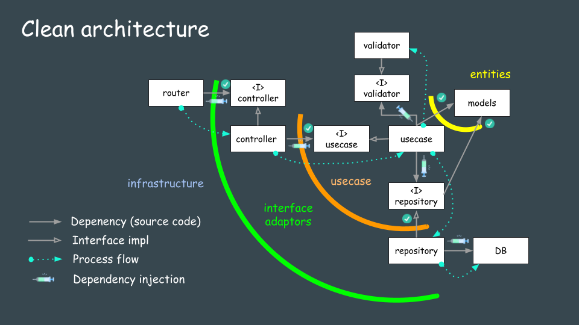

# Go Echo Template

A lightweight and scalable template for building Go web applications using the **Echo** web framework. This template is designed to help you quickly get started with building REST APIs or web applications in Go, providing a clean structure and essential tools like hot reloading and Docker support.

## Features

- **Fast and lightweight**: Powered by the high-performance [Echo](https://echo.labstack.com/) web framework.
- **Hot reload**: Use [Air](https://github.com/cosmtrek/air) for live reloading during development.
- **Environment management**: Manage environment variables with a `.env` file.
- **Modular architecture**: Easily extend and customize your application as it grows.

## Installation

### Prerequisites

- **Go**: [Install Go](https://golang.org/dl/)
- **Air** (for live reloading, optional but recommended): [Install Air](https://github.com/cosmtrek/air)

### Getting Started

1. **Clone the repository:**

   ```bash
   git clone https://github.com/yourusername/go-echo-template.git
   cd go-echo-template
   ```
2. **Initialize Go modules:**
    ```bash
    go mod init go-echo-template
    ```
3. **Start the application:**

    You can start the app using either the built-in Go command or with Air for hot reloading.

    Without hot reloading:
    ```bash
    go run .
    ```

    With Air (for hot reload):
    
    If you prefer live-reloading while developing, use Air
     to automatically reload the app on code changes.
    
    ```bash
    air
    ```


  The server will start at http://localhost:8080 by default.


# ARCHITECTURE

    
